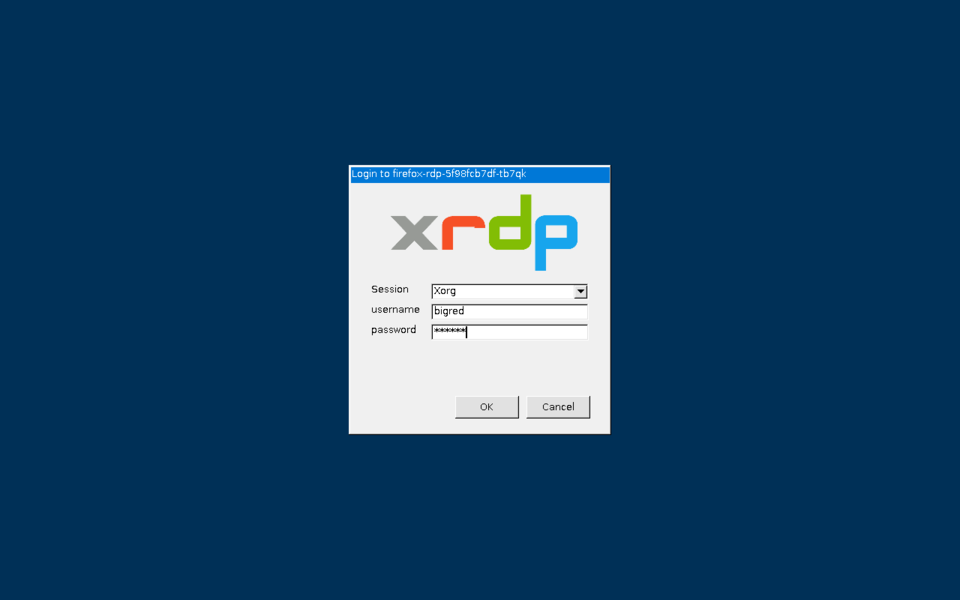
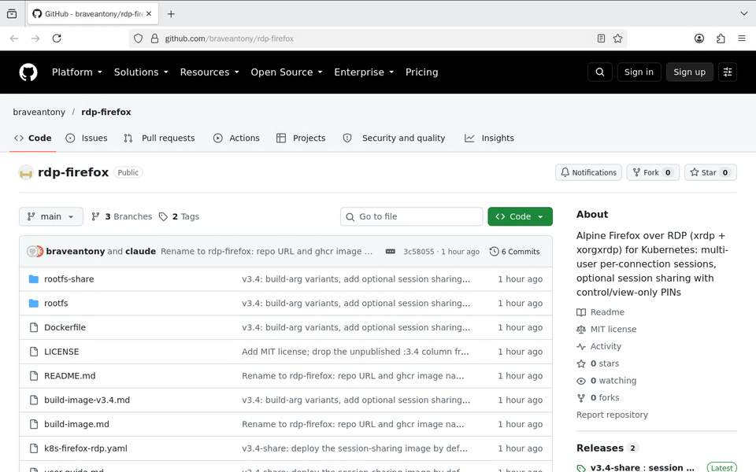
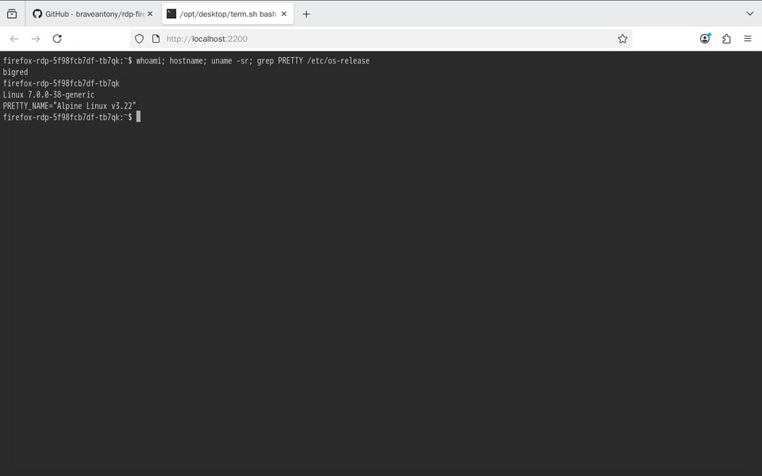
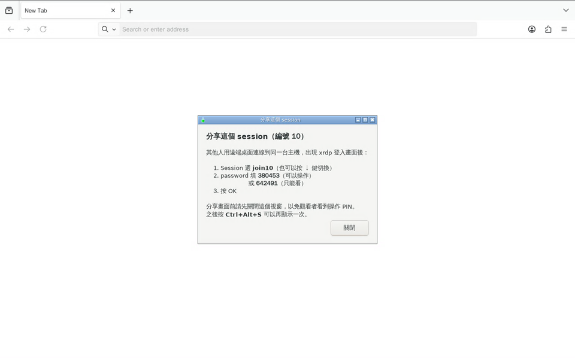
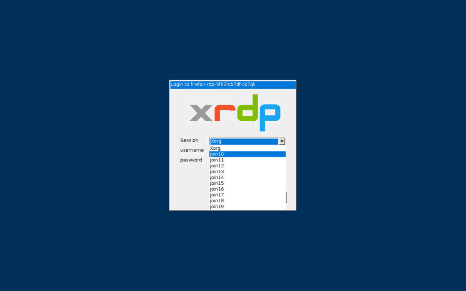
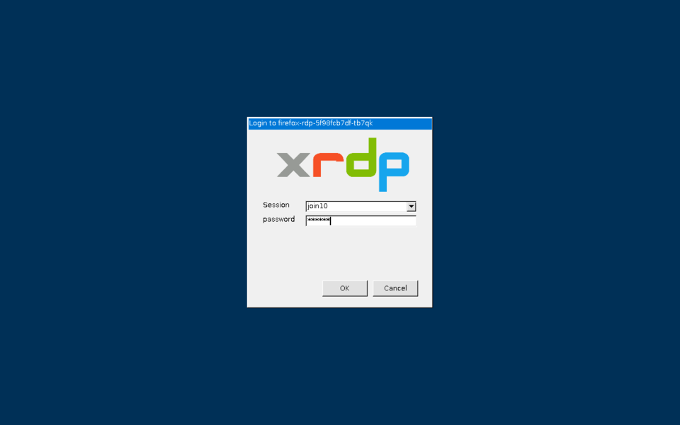
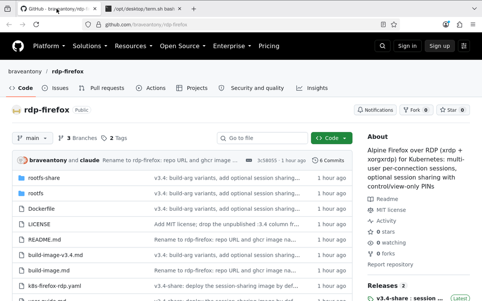

# rdp-firefox

用 Windows 遠端桌面（RDP）登入後，就能用全螢幕 Firefox 與 Web 終端機存取 Kubernetes 叢集內的服務。支援多人同時使用：每人各有獨立桌面，也能分享給別人觀看或共同操作。

## 簡述

- **叢集的入口，Web 與 CLI 兼備**：登入後的桌面就在 Kubernetes 叢集裡，直接存取叢集內的服務
  - **Web**：Firefox 以 `http://<service>.<namespace>`（Service 名稱加上所在的 namespace，以半形句點 `.` 分隔，例如 `http://grafana.monitoring`）直達叢集內的 Web 應用
  - **CLI**：`localhost:2210` 以 SSH 連到叢集內的管理 Pod（tkadm）操作 Kubernetes，kubeconfig 不必離開叢集
  - 只需開放一個 NodePort（30389），叢集內的 Web 服務不必另外對外開放，也不用裝 MetalLB 或 kube-vip
- **零安裝、即連即用**：Windows 內建遠端桌面一鍵連線，免裝任何用戶端或外掛，登入後即可使用全螢幕 Firefox
- **多人並行、彼此隔離**：多個帳號、甚至同一帳號都能多人同時登入，每次登入都有自己的桌面、瀏覽器與下載目錄，每個終端機分頁也各有獨立的 shell，互不干擾
- **中文輸入無縫接軌**：桌面內建新酷音（注音），按左 `Shift` 即可切換中英；也能從本機剪貼簿直接貼上
- **即時協作、權限分明**（`-share` 版）：一組 PIN 即可邀請他人加入你的桌面，唯讀觀摩或共同操作由你決定

## 架構

詳細說明請參考 [docs/architecture.md](docs/architecture.md)。

## 快速開始

在已安裝 kubectl、curl、bash，且連得到目標 Kubernetes 叢集的電腦上執行：

```bash
curl -fsSL https://raw.githubusercontent.com/braveantony/rdp-firefox/main/install.sh | bash
```

腳本會部署到 namespace `web-workspace`，完成後印出每個節點的連線位址。用遠端桌面連線到 `<節點 IP>:30389`，帳號 `bigred`、密碼 `bigred`。

先決條件、多個帳號（Kustomize）、更換映像檔、升級與移除，請見 [docs/install.md](docs/install.md)。

## 怎麼用

### 1. 登入

按 `Win+R`、輸入 `mstsc`，開啟「遠端桌面連線」，連到 `<節點 IP>:30389`（安裝完成時會印出）。出現憑證警告時按「是」（憑證是 Pod 每次啟動時自行產生的自簽憑證，所以 Pod 重建後會再出現一次）。接著會看到 xrdp 登入畫面：Session 保持 `Xorg`，輸入帳號密碼後按 OK。



### 2. 使用 Firefox

登入後畫面上只有全螢幕的 Firefox。關掉它會在 1 秒內自動重開；解析度會配合遠端桌面視窗大小調整。下載檔案時會詢問儲存位置。

輸入中文：本機輸入法保持英文，在遠端桌面裡單獨按一下左 `Shift`（或 `Ctrl+Space`）切換到注音（新酷音），再按一次切回英文。也可以在本機打好後複製，再到 Firefox 按 `Ctrl+V` 貼上（Mac 用 `Cmd+V`）。

在網址列輸入 `http://<service>.<namespace>` 即可開啟叢集內的 Web 服務，不必另外把該服務開放到叢集外。服務的埠號不是 80 時，在網址後加上 `:<埠號>`，例如 `http://grafana.monitoring:3000`；埠號就是 Service 的 port，可用 `kubectl get svc -n <namespace>` 查看。



> 每次以 Xorg 登入都是獨立的新桌面：斷線後無法接回，原本的分頁與下載的檔案會在 2 分鐘後清除。

### 3. Web 終端機

在 Firefox 網址列輸入 `localhost:2200` 就是 bash 終端機，`localhost:2210` 則以 SSH 連到 `SSH_TARGET`（預設 `tkadm.taroko`；映像檔已預先設定好，連 tkadm 時會自動使用 22100 埠）。每個分頁都有獨立的 shell，關掉分頁就會結束；除了多帳號模式的 `localhost:2200`（使用該帳號的家目錄，檔案會保留）之外，分頁裡的家目錄都是暫時的，關掉分頁就刪除。終端機只能在遠端桌面裡的 Firefox 開啟，從你自己電腦的瀏覽器連不到。

在終端機裡貼上請按 `Ctrl+Shift+V` 或 `Shift+Insert`（Mac 上是 `Control+Shift+V`），因為 `Ctrl+V` 會被當成控制字元送進終端機。

只設定一個帳號時，`localhost:2200` 直接以該帳號開啟 bash；設定多個帳號時，會先出現 `login:` 提示，輸入自己的帳號密碼後才進入 bash，避免不小心以別人的身分操作；同一帳號開的多個分頁共用該帳號的家目錄。`localhost:2210` 在只設定一個帳號時，以同名帳號 SSH 登入（需輸入 SSH 目標上的密碼）；設定多個帳號時，會先詢問要用 SSH 目標上的哪個帳號。



### 4. 分享你的桌面（`-share` 版）

登入約 2 秒後，畫面中央會出現這個桌面的**編號**、**操作 PIN**（可以操作）與**唯讀 PIN**（只能看）。依需要把其中一組 PIN 告訴對方即可。關掉視窗後，可按 `Ctrl+Alt+S` 再次叫出；**開始分享前請先關掉這個視窗**，以免加入者看到操作 PIN。



### 5. 加入別人的桌面

1. 同樣用遠端桌面連到同一個位址，會出現 xrdp 登入畫面。
2. **Session** 改選 `join<編號>`（例如 `join10`；編號從 10 起，可分享的是 10～19），可用滑鼠選或按 `↓` 鍵。

   

3. 表單只剩 **password** 一欄，填入對方給的 PIN，按 OK。

   

4. 加入後就會看到對方的畫面：用唯讀 PIN 時所有輸入都無效，用操作 PIN 時可以一起操作（滑鼠鍵盤與對方共用）。分享不限帳號：任何人只要拿到 PIN 都能加入。

   

加入後的畫面大小固定與分享者相同，視窗無法放大到全螢幕。需要時在遠端桌面連線的標題列按右鍵，勾選「智慧型調整大小」（Smart sizing），畫面就會跟著視窗縮放。

> 不要在 username 填 `join10\bigred` 之類的名稱：Session 仍是 `Xorg` 時會被當成帳號而登入失敗。

## 版本比較

| | v3.2 | v3.4-share | v3.5-share | v3.6-share | v3.7-share |
| --- | --- | --- | --- | --- | --- |
| 映像檔 | `ghcr.io/braveantony/rdp-firefox:3.2` | `ghcr.io/braveantony/rdp-firefox:3.4-share` | `ghcr.io/braveantony/rdp-firefox:3.5-share` | `ghcr.io/braveantony/rdp-firefox:3.6-share` | `ghcr.io/braveantony/rdp-firefox:3.7-share` |
| 同一帳號多人同時登入、各自獨立桌面 | ✅ | ✅ | ✅ | ✅ | ✅ |
| localhost:2200／2210 Web 終端機 | ✅ | ✅ | ✅ | ✅ | ✅ |
| 分享自己的桌面（操作 PIN／唯讀 PIN） | — | ✅ | ✅ | ✅ | ✅ |
| 多個帳號（Secret 帳號檔案） | — | — | ✅ | ✅ | ✅ |
| `curl \| bash` 安裝、Kustomize 部署 | — | — | ✅ | ✅ | ✅ |
| 桌面內直接輸入中文（新酷音） | — | — | — | ✅ | ✅ |
| 2210 免設定直連 tkadm（22100 埠）、設定多個帳號時詢問 SSH 帳號 | — | — | — | — | ✅ |
| 映像檔大小 | 約 790 MB | 約 1.04 GB | 約 1.04 GB | 約 1.08 GB | 約 1.08 GB |
| 原始碼 | branch [`release/3.2`](../../tree/release/3.2) | branch [`release/3.4-share`](../../tree/release/3.4-share) | branch [`release/3.5-share`](../../tree/release/3.5-share) | branch [`release/3.6-share`](../../tree/release/3.6-share) | branch [`release/3.7-share`](../../tree/release/3.7-share)（= `main`） |

`images/rdp-firefox/Dockerfile` 用建置參數 `SESSION_SHARE` 區分是否加入分享功能：`SESSION_SHARE=1` 建出 `-share` 版；`SESSION_SHARE=0`（預設）建出不含分享功能的版本（此版本未另外發布映像檔）。各版本的差異說明見 [Releases](../../releases)。

## 文件

- [install.md](docs/install.md)：安裝（先決條件、快速開始、多個帳號、更換映像檔、升級、移除）
- [architecture.md](docs/architecture.md)：系統運作架構（連線路徑、Pod 內各 process 的職責、安全邊界）
- [user-guide.md](docs/user-guide.md)：使用手冊（連線登入、Firefox 與中文、終端機、多人使用、分享與加入桌面、常見問題）
- [build-image-v3.4.md](docs/build-image-v3.4.md)：從零建置 `:3.4` 與 `:3.4-share`，並部署到 Kubernetes（tk8s）的完整步驟
- [build-image.md](docs/build-image.md)：v3.2（只有多人獨立桌面，沒有分享功能）的建置步驟

## 環境變數

| 變數 | 預設值 | 說明 |
| --- | --- | --- |
| `USERS_FILE` | `/etc/firefox-rdp/users` | 帳號檔案，一行一個 `帳號:密碼`；Kubernetes 上由 Secret `firefox-rdp-users-*` 掛載。檔案存在且非空時忽略下面兩個變數 |
| `RDP_USER` | `bigred` | 沒有帳號檔案時的登入帳號（UID 1000） |
| `RDP_PASSWORD` | — | 沒有帳號檔案時的登入密碼（此時必填） |
| `MAX_SESSIONS` | `4` | 可同時存在的桌面數上限；加入別人桌面的連線不占名額。`-share` 版只能分享編號 10～19 的桌面，設超過 10 時，多出來的桌面無法分享 |
| `SSH_TARGET` | `tkadm.taroko` | `localhost:2210` 終端機的 SSH 目標。連 `tkadm.taroko` 時自動使用 22100 埠（`/etc/ssh/ssh_config.d/tkadm.conf`）；其他主機要指定埠號時寫成 `ssh://<主機>:<埠>` |

## 檔案

| 路徑 | 說明 |
| --- | --- |
| `VERSION` | 目前版本 |
| `images/rdp-firefox/Dockerfile` | 映像檔定義（基底 `alpine:3.22`；`SESSION_SHARE=1` 時加裝桌面分享功能） |
| `images/rdp-firefox/rootfs/` | 所有版本都會複製進映像檔 `/` 的設定檔與腳本 |
| `images/rdp-firefox/rootfs-share/` | 只有 `-share` 版會套用的分享功能檔案 |
| `install.sh` | 快速開始的 `curl \| bash` 安裝腳本（帳號 bigred/bigred） |
| `manifests/base/` | Kustomize base（共用的基本設定）：Namespace、Deployment、NodePort Service（30389） |
| `manifests/multi-user/` | 多帳號 overlay（疊加在 base 上的修改）：由 `users.txt` 帳號清單產生 Secret |
| `docs/` | 架構說明、使用手冊、建置文件、架構圖（`docs/architecture/`）與 README 截圖（`docs/images/`） |
| `test/e2e/` | 在臨時 kind 叢集（用容器模擬的測試用 Kubernetes 叢集）上執行的端到端驗證腳本 |
| `test/architecture/` | 對已部署的叢集核對[架構文件](docs/architecture.md)說法的驗證腳本 |

## 授權

[MIT License](LICENSE)
