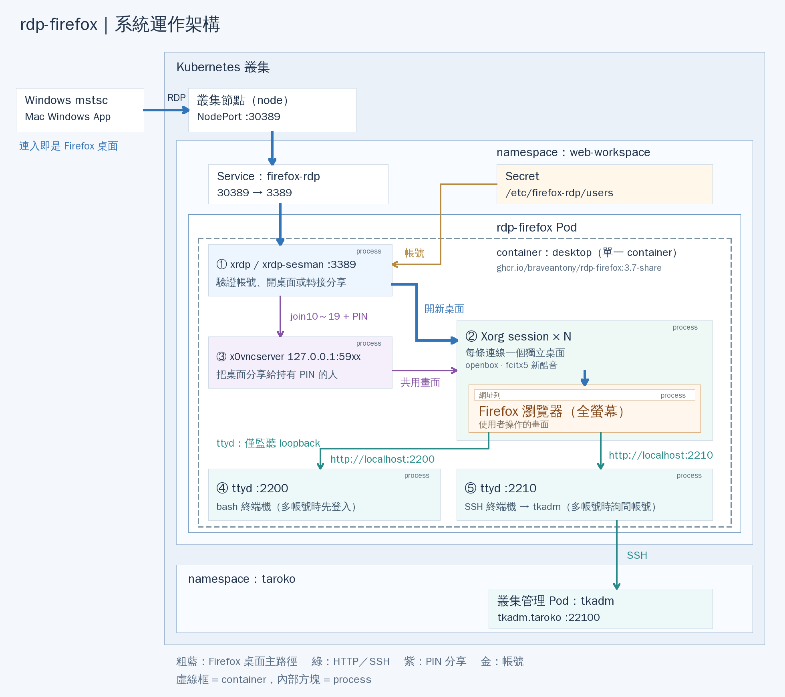

# rdp-firefox 系統運作架構

適用映像檔：`ghcr.io/braveantony/rdp-firefox:3.7-share`

圖中的編號、顏色與下文對應。架構圖的原始檔與重製方式見 [architecture/README.md](architecture/README.md)。

## 連線路徑（粗藍線）

1. 使用者在 Windows 用「遠端桌面連線」（`mstsc`），或在 Mac 用 Windows App，以 **RDP** 連到叢集任一節點的 **NodePort `30389`**。
2. NodePort 屬於 namespace `web-workspace` 的 **Service `firefox-rdp`**，它把 30389 轉到 Pod 的 **3389** 埠。NodePort 和 Pod 不一定在同一個節點，由 Kubernetes 負責轉送。
3. 連線進入 **rdp-firefox Pod**。登入後，使用者看到的就是全螢幕的 Firefox 瀏覽器。

## Pod 內部

Pod 只有**一個 container `desktop`**，也就是圖中的虛線框。框內的方塊都是這個 container 裡的 **process**，由 `tini` 與 `/opt/desktop/entrypoint.sh` 啟動。任一常駐服務結束時，container 就會停止，交給 Kubernetes 重啟。

| # | process | 職責 |
| --- | --- | --- |
| ① | **xrdp / xrdp-sesman** `:3389` | RDP 入口。xrdp 顯示登入畫面，sesman 用 PAM 驗證帳號。登入時選 **Xorg** 會開一個新桌面（②）；選 **join10～19** 則把連線轉給 ③ |
| ② | **Xorg session × N** | 每條 RDP 連線一個獨立桌面，同一帳號連兩次也是兩個桌面，上限為 `MAX_SESSIONS`（預設 4）。桌面裡跑 openbox、fcitx5 新酷音（中文輸入）與**全螢幕 Firefox**，Firefox 就是使用者操作的畫面。斷線 2 分鐘後清除 |
| ③ | **x0vncserver** `127.0.0.1:59xx` | 分享桌面（`-share` 版）。其他人在登入畫面選 `join<編號>`：輸入操作 PIN 可共同操作，輸入唯讀 PIN 只能觀看 |
| ④ | **ttyd** `:2200` | 網頁 bash 終端機。單一帳號時直接進入該帳號；多帳號時先要求登入 |
| ⑤ | **ttyd** `:2210` | 網頁 SSH 終端機，連到 tkadm。多帳號時先詢問要用哪個 SSH 帳號 |

## 其他連線

- **綠線（HTTP / SSH）**
  - 在 Firefox 開啟 `http://localhost:2200` 或 `http://localhost:2210`，分別連到 ④ 或 ⑤。
  - ttyd 只監聽 loopback，叢集外連不到；`-O` 會拒絕其他網頁發出的 WebSocket 連線。
  - ⑤ 以 SSH 連到 namespace `taroko` 的**叢集管理 Pod tkadm**（`tkadm.taroko:22100`），在那裡用 kubectl 管理叢集。
  - 映像檔內建 `/etc/ssh/ssh_config.d/tkadm.conf`，會自動使用 22100 埠，不必另外設定 `SSH_TARGET`。
- **紫線（PIN 分享）**：① 收到 join 連線後轉給 ③，③ 再共用 ② 的畫面。
- **金線（帳號）**
  - Secret `firefox-rdp-users-<雜湊>` 以唯讀方式掛載到 `/etc/firefox-rdp/users`，每行一個 `帳號:密碼`。
  - Pod 啟動時，`entrypoint.sh` 依這個檔案建立登入帳號（UID 從 1000 起），① 用這些帳號驗證登入。

## 安全邊界

- 叢集外只有 NodePort `30389`（RDP）一個入口。
- ttyd（2200、2210）與 VNC（59xx）都只監聽 Pod 內的 loopback。
- xrdp listener 以無權限的 `xrdp` 帳號執行。
- tkadm 的 kubeconfig 留在叢集內，不必流出到用戶端。
